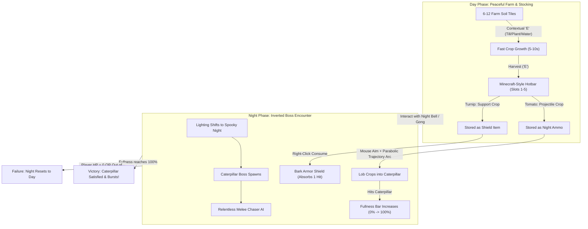

# MoFarmSand: Golden Slice Implementation Plan

## 1. Overview & Aligned Architecture

This roadmap details the end-to-end execution of the **Golden Slice** prototype for *MoFarmSand*. The goal is a focused, camera-ready, and fully playable loop following all directives in [AGENTS.md](../../AGENTS.md) and [implementation-guide.md](implementation-guide.md).

> **Tasks:** this plan is split into per-phase agent task files, see [tasks/00-index.md](tasks/00-index.md).



---

## 2. Decision Record Summary

| Design Dimension | Aligned Decision |
| :--- | :--- |
| **Camera View** | Animal Crossing style high-angle front-facing follow camera (fixed ~40° pitch, smoothly tracks player). |
| **Controls & Aiming** | WASD movement + Mouse cursor aiming with parabolic trajectory arc and ground target indicator. |
| **Inventory System** | Minecraft-style hotbar (slots 1–5, number keys/scroll wheel, visual held item, stack counts). |
| **Farming Interaction** | Contextual single key (`E` / Space) to till -> plant -> water -> harvest; rapid 5–10s growth. |
| **Projectile Crop** | Tomato / Berry: Lobbed at Caterpillar to increase Fullness meter. |
| **Support Crop** | Turnip / Carrot: Consumed via Right-Click to grant a 1-hit Bark Shield. |
| **Boss AI** | Super simple melee chase: crawls directly toward the Dog Farmer to tackle. |
| **Ammo Constraint** | Strict ammo cap: only crops harvested during the Day are available during the Night fight. |
| **Art Assets** | Minimalist modular primitives (Sphere dog with directional cube snout, multi-sphere segmented caterpillar, spherical crops) ready for FBX drop-in. |
| **UI Presentation** | Ultra-simple debug UI (Unity `OnGUI` / clean text overlays for Fullness %, HP, Shield, and Hotbar). |

---

## 3. Directory & File Structure

```text
Assets/
├── Scripts/
│   ├── Data/
│   │   ├── CropData.cs            # ScriptableObject: Crop stats, type, growth duration, fullness value
│   │   └── BossData.cs            # ScriptableObject: Boss health/fullness goal, speed, damage
│   ├── Player/
│   │   ├── PlayerController.cs    # WASD movement, rotation, and ground clamping
│   │   ├── PlayerInventory.cs     # Minecraft hotbar (5 slots), active slot selection, stack counts
│   │   ├── PlayerHealth.cs        # HP + Bark Shield (absorbs 1 hit)
│   │   ├── PlayerCombat.cs        # Mouse aiming, throw cooldown, support crop consumption
│   │   └── TrajectoryRenderer.cs  # Visual parabolic arc line renderer + landing decal
│   ├── Farming/
│   │   ├── FarmTile.cs            # Contextual tile state machine (Empty -> Seeded -> Growing -> Harvestable)
│   │   └── CropProjectile.cs      # Parabolic physics, collision detection with boss/ground
│   ├── Boss/
│   │   ├── CaterpillarBoss.cs     # Super simple melee chase state machine & tackle logic
│   │   └── BossHunger.cs          # Inverted health tracking (0% -> 100%), victory event trigger
│   └── Core/
│       ├── GameManager.cs         # Day/Night coordinator, win/lose states, ammo tracking
│       ├── AnimalCrossingCamera.cs# Smooth follow camera with fixed pitch/yaw
│       └── DebugHUD.cs            # OnGUI display for Fullness %, HP, Shield, Hotbar
├── Prefabs/
│   ├── Player_Primitive.prefab
│   ├── Caterpillar_Primitive.prefab
│   ├── Tomato_Projectile.prefab
│   ├── FarmTile.prefab
│   └── Bell_Trigger.prefab
└── Scenes/
    └── GoldenSliceScene.unity
```

---

## 4. Implementation Phases

### Phase 1: ScriptableObject Architecture & Core Contracts
1. Create `CropData.cs` and `BossData.cs` inheriting from `ScriptableObject`.
2. Generate baseline assets:
   - `Crop_Tomato.asset`: Type = Projectile, GrowTime = 6s, FullnessValue = 20%.
   - `Crop_Turnip.asset`: Type = Support, GrowTime = 8s, ShieldCharges = 1.
   - `Boss_Caterpillar.asset`: MaxFullness = 100, ChaseSpeed = 3.5, Damage = 1.

### Phase 2: Player Movement & Animal Crossing Camera
1. Create `PlayerController.cs` with CharacterController or Kinematic Rigidbody.
2. Build primitive Dog avatar (Sphere body + Cube snout pointing forward).
3. Implement `AnimalCrossingCamera.cs` with configurable offset (e.g., `(0, 9, -10)` and `rotation = (40, 0, 0)`).

### Phase 3: Minecraft Hotbar & Throw Aiming Arc
1. Implement `PlayerInventory.cs` with 5 fixed slots, active slot selection (`1`-`5`, scroll wheel), and stack counting.
2. Implement `TrajectoryRenderer.cs` calculating standard ballistic parabola:
   $$r(t) = p_0 + v_0 t + \frac{1}{2} g t^2$$
   projected toward the ground plane mouse intersection.
3. Hook left-click to instantiate and throw `CropProjectile.cs`.
4. Hook right-click to consume Turnip and apply Bark Shield (`hasShield = true`).

### Phase 4: Farm Soil Grid & Contextual Interaction
1. Implement `FarmTile.cs` with 4 visual states (Tilled soil -> Sprout -> Mature -> Harvestable highlight).
2. Contextual single-key interaction (`E`):
   - Empty -> Plants selected seed or default seed.
   - Growing -> Shows remaining countdown timer.
   - Mature -> Harvests crop into player hotbar.
3. Lay out a 3x3 or 2x4 grid in `GoldenSliceScene.unity`.

### Phase 5: Caterpillar Boss Chaser & Inverted Hunger
1. Build `Caterpillar_Primitive.prefab` (3-4 linked spheres that follow head with squash/stretch).
2. Implement `CaterpillarBoss.cs`:
   - Finds player position and crawls toward player at `chaseSpeed`.
   - On contact with player: deals damage (or breaks Bark Shield if active) with knockback.
3. Implement `BossHunger.cs`:
   - Listens for `CropProjectile` impacts.
   - Adds `fullnessValue` and scales caterpillar slightly larger (+squish wobble).
   - Fires `OnBossSatisfied` when Fullness $\ge 100\%$.

### Phase 6: Day/Night Cycle, Win/Loss States & Debug UI
1. Create `GameManager.cs`:
   - Tracks Day vs. Night state.
   - "Night Bell / Gong" primitive in the farm to transition to Night.
   - In Night mode, boss wakes up; player cannot farm more crops (strict ammo cap).
   - If player runs out of crops and Fullness < 100%, trigger Night Reset.
2. Create `DebugHUD.cs` (`OnGUI`):
   - Top-Center: Large Green Fullness Bar `[======    ] 60%`.
   - Top-Left: Player HP `[❤❤❤]` + Shield indicator `[🛡 BARK SHIELD]`.
   - Bottom-Center: 5 Hotbar boxes highlighting active slot and item count.
3. Validate compilation and playability.
