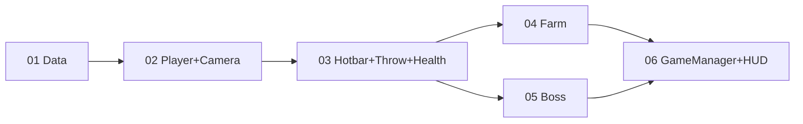

# Golden Slice: Task Index

Split from [../plan.md](../plan.md). Each task is self-contained: hand one file to an agent. Read [AGENTS.md](../../../AGENTS.md) and [implementation-guide.md](../implementation-guide.md) first.

| # | Task | Depends on | Parallel with |
|---|------|-----------|---------------|
| 01 | [ScriptableObjects & data assets](01-scriptable-objects.md) | none | none |
| 02 | [Player movement & camera](02-player-camera.md) | 01 | none |
| 03 | [Hotbar, throwing & player health](03-hotbar-throwing.md) | 01, 02 | none |
| 04 | [Farm tiles](04-farm-tiles.md) | 01, 02, 03 | 05 |
| 05 | [Caterpillar boss & hunger](05-caterpillar-boss.md) | 01, 02, 03 | 04 |
| 06 | [GameManager, win/lose & HUD](06-gamemanager-hud.md) | 01-05 | none |

## Shared contracts (single source; tasks must not deviate)

- `CropData : ScriptableObject` - `cropId`, `displayName`, `type` (`CropType.Projectile | Support`), `growTime`, `fullnessValue`, `shieldCharges`, `projectilePrefab`, `icon`/`color`.
- `BossData : ScriptableObject` - `maxFullness`, `chaseSpeed`, `damage`.
- `PlayerInventory` - `bool AddItem(CropData, int)`, `bool TryConsume(CropData, int)`, `int TotalCount()`, `CropData ActiveCrop`, `event Action OnChanged`.
- `PlayerHealth` - `int Hp`, `bool HasShield`, `void GrantShield()`, `void TakeDamage(int)` (shield absorbs one hit), `event Action OnChanged`, `event Action OnDied`.
- `BossHunger` - `void Feed(float fullness)`, `float Fullness01`, `event Action<float,float> OnBossFed`, `event Action OnBossSatisfied`.
- `GameManager` - `GamePhase Phase` (`Day | Night | Won | Lost`), `bool CanFarm`, `event Action<GamePhase> OnPhaseChanged`.

## Global guardrails
Data in ScriptableObjects (no JSON), no god objects, events only at seams, cache references in `Awake`, check for existing files before creating, check the Unity console after every compile. Out of scope: seasons, save systems, extra bosses.
